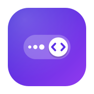
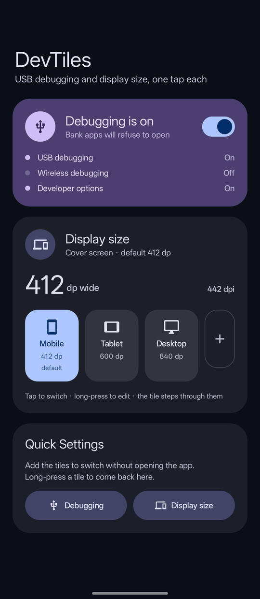
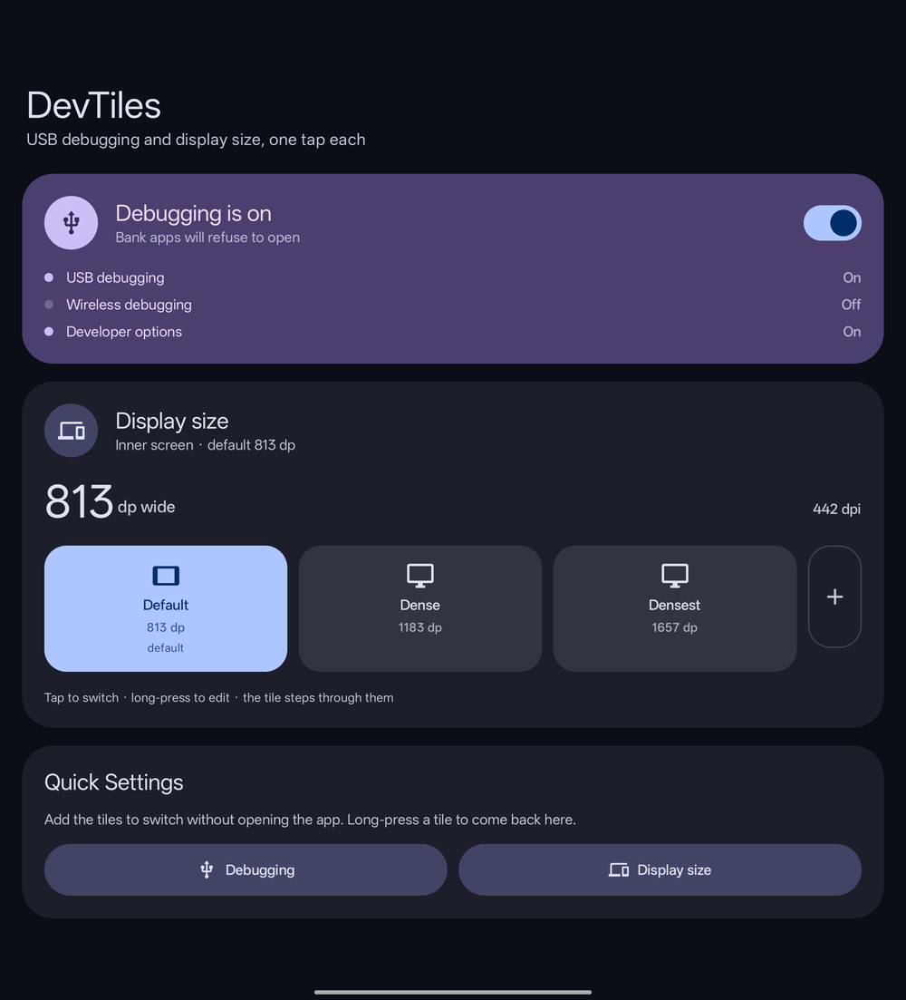
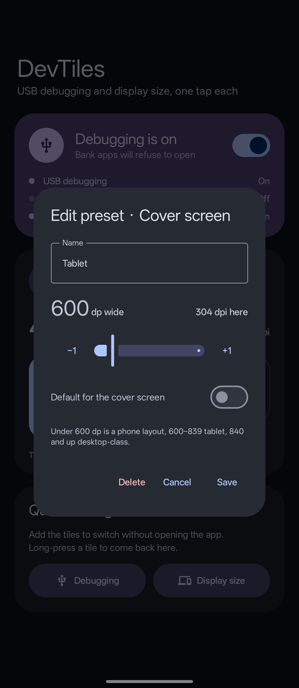
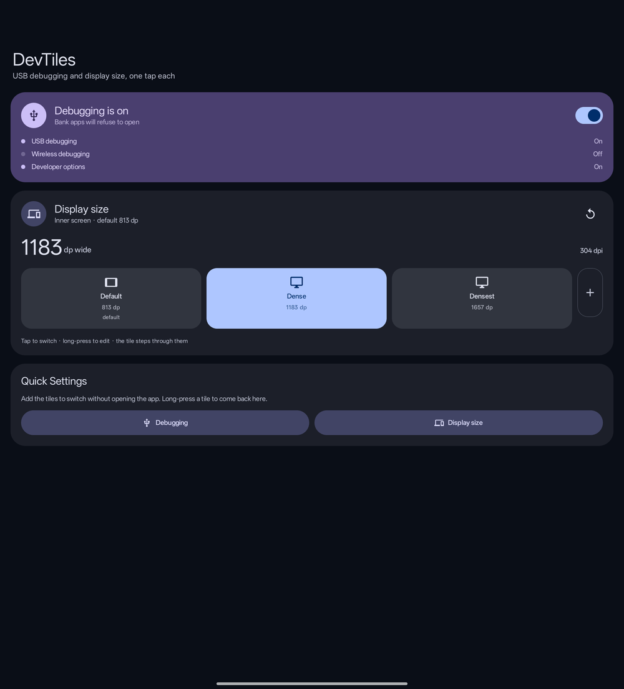

<p align="center">
  
</p>

<h1 align="center">Android DevTiles</h1>

<p align="center">
  Two Quick Settings tiles for Android developers: switch <b>USB debugging</b> off and on, and step through
  <b>display size</b> presets, without opening Settings or rebooting.
</p>

<p align="center">
  
  &nbsp;
  
</p>

## Why

- **Banking (and other) apps refuse to open while USB debugging or Developer options is on.** Turning them off in
  Settings is several taps, and on some phones (ColorOS) turning Developer options off asks for a reboot. The
  debugging tile turns both off in one tap, and on again when you're back at your desk.
- **Checking a layout at another width** (phone, tablet, desktop-class) means `adb shell wm density` or digging into
  Developer options. The display size tile steps through your own presets, per screen on a foldable.

No root, no Shizuku, no Accessibility service, no overlay. The one requirement is `WRITE_SECURE_SETTINGS`, granted once
over adb.

## Features

### USB debugging tile

- **Off** writes `Settings.Global` `adb_wifi_enabled=0`, `adb_enabled=0`, `development_settings_enabled=0`: wireless
  debugging, USB debugging and Developer options all off.
- **On** writes `development_settings_enabled=1`, `adb_enabled=1` (wireless debugging is left alone).
- The tile follows the setting live, so it stays right when debugging is changed in Settings or over adb.
- Turning debugging *on* from the lock screen asks you to unlock first; turning it off always works.

Once the tile turns USB debugging off, adb is gone until you tap it again.

### Display size tile

- A preset is a **smallest width in dp**, the same thing as Developer options → *Smallest width*:
  density = shortest side in px × 160 / dp, truncated both ways like Settings does.
- **Per screen.** Android keeps a forced density per physical screen, so a foldable's cover and inner screens each
  have their own presets and their own default. The app tells them apart by panel resolution and shows which screen
  it is on.
- Tap a preset in the app to apply it, long-press to edit it (name, width, default for this screen), up to 5 per screen.
  The reset button goes back to the screen's default preset.
- The tile steps to the next preset; from a size no preset has, it goes to the default.
- First-run presets, at the same density steps on both screens of a Find N6 (442 / 304 / 217 dpi):

  | Screen | Default | Step 2 | Step 3 |
  |---|---|---|---|
  | Phone / cover | Mobile 412 dp | Tablet 600 dp | Desktop 840 dp |
  | Foldable inner | Default 813 dp | Dense 1183 dp | Densest 1657 dp |

<p align="center">
  
  &nbsp;
  
</p>

Long-press either tile to open the app.

## Setup

1. Build and install the app (see [Build](#build)). Android 14 or newer.
2. Grant `WRITE_SECURE_SETTINGS` once from a computer:

   ```bash
   adb shell pm grant dev.theiceji.debugtoggle android.permission.WRITE_SECURE_SETTINGS
   ```

   The grant survives app updates. On **ColorOS 16** it fails with
   `Neither user 2000 nor current process has android.permission.GRANT_RUNTIME_PERMISSIONS` until Developer options →
   **Disable system optimization** is on (switch the phone to English if you can't find it).
3. Open DevTiles and add the tiles with the two buttons at the bottom, or from the Quick Settings editor.

The package name is `dev.theiceji.debugtoggle` (the app was called Debug Toggle first; it stays so existing installs
keep their grant and presets).

## How it works

- Debugging: plain `Settings.Global` writes, allowed by `WRITE_SECURE_SETTINGS`.
- Display size: `IWindowManager.setForcedDisplayDensityForUser`, the call behind `adb shell wm density`, which checks
  `WRITE_SECURE_SETTINGS`. Writing `display_density_forced` alone only takes effect after a reboot. The method is a
  `max-target-o` hidden API (reflection is denied for apps targeting newer SDKs), so the app uses
  [AndroidHiddenApiBypass](https://github.com/LSPosed/AndroidHiddenApiBypass) to reach it.
- UI: Jetpack Compose, Material 3 with dynamic colour, light and dark.

Tested on a Find N6 (ColorOS 16, Android 16), both screens, and the Android 17 emulator (API 37).

## Build

Requires JDK 17+ (Android Studio's bundled JBR works) and the Android SDK.

```bash
./gradlew assembleRelease assembleBenchmark assembleDebug
```

Every assemble copies its APK to `build/<versionName>/` at the project root (`devtiles-0.3.0-release.apk`,
`-benchmark`, `-debug`), and release also its R8 mapping (`devtiles-0.3.0-mapping.txt`).

- **release**: R8-minified. It's signed when `~/.keystores/devtiles-release.properties` exists, and unsigned otherwise:

  ```properties
  storeFile=devtiles-release.jks   # relative to the .properties file
  storePassword=…
  keyAlias=…
  keyPassword=…
  ```

  Keystores and their passwords never go in the repo (`.gitignore` blocks `*.jks` and `*.keystore`).
- **benchmark**: the release build signed with the debug key, profileable.
- **debug**: debug key.

Release and debug builds are signed with different keys, so switching between them on a phone means uninstalling
first and granting the permission again.

AGP 9.4, Gradle 9.7, Kotlin (built into AGP) with Compose BOM 2026.09, minSdk 34, targetSdk 36.

## License

Copyright 2026 Jirayu-ninl. [Apache License 2.0](LICENSE). Uses AndroidX / Jetpack Compose and AndroidHiddenApiBypass, both Apache 2.0.
